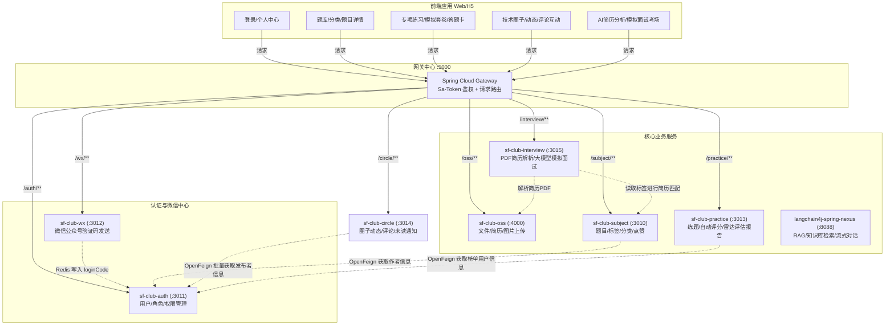

# 烤面筋（sf-club）微服务项目接口请求全量文档

本文档专为**前端页面开发与联调**定制，涵盖系统中各微服务接口的详细规范、网关映射规则、模块间调用关系及核心业务流。

---

## 一、 系统架构与前端请求规范

### 1. 网关路由与地址映射说明
前端所有请求统一通过 **Spring Cloud Gateway（默认端口 5000）** 访问后端微服务。
网关配置了 `StripPrefix=1`，即**网关会截掉第一级路由前缀后转发给下游服务**。因此，前端发起请求时的 URL 需拼接网关路由前缀：

| 服务模块 | 服务名 | 服务端口 | 网关路由前缀 | 前端请求完整基准路径示例 | 下游微服务接收路径 |
| :--- | :--- | :--- | :--- | :--- | :--- |
| **网关服务** | `sf-club-gateway` | 5000 | `/` | `http://localhost:5000/` | - |
| **鉴权/用户服务** | `sf-club-auth` | 3011 | `/auth/` | `http://localhost:5000/auth/user/doLogin` | `/user/doLogin` |
| **题目/题库服务** | `sf-club-subject` | 3010 | `/subject/` | `http://localhost:5000/subject/subject/category/queryPrimaryCategory` | `/subject/category/queryPrimaryCategory` |
| **在线练习服务** | `sf-club-practice` | 3013 | `/practice/` | `http://localhost:5000/practice/practice/set/getSpecialPracticeContent` | `/practice/set/getSpecialPracticeContent` |
| **圈子/社区服务** | `sf-club-circle` | 3014 | `/circle/` | `http://localhost:5000/circle/circle/share/moment/getMoments` | `/circle/share/moment/getMoments` |
| **模拟面试服务** | `sf-club-interview`| 3015 | `/interview/`| `http://localhost:5000/interview/interview/analyse` | `/interview/analyse` |
| **微信服务** | `sf-club-wx` | 3012 | `/wx/` | `http://localhost:5000/wx/callback` | `/callback` |
| **对象存储服务** | `sf-club-oss` | 4000 | `/oss/` | `http://localhost:5000/oss/upload` | `/upload` |
| **AI/大模型服务**| `langchain4j-spring-nexus` | 8088 (独立) | 直连/独立网关 | `http://localhost:8088/ai/chat` | `/ai/chat` |

> [!WARNING]
> **注意双重前缀命名规则**：
> 如 `sf-club-subject` 控制器本身自带 `@RequestMapping("/subject")`，经过网关转发时：
> 前端必须请求 `/subject/subject/add`，网关剥除首个 `/subject` 后，下游接收到 `/subject/add`。同理，圈子为 `/circle/circle/...`，练习为 `/practice/practice/...`。

---

### 2. 统一鉴权机制（Sa-Token）
- **认证方式**：使用 Sa-Token 框架。
- **登录凭证传递**：登录成功后，前端从 `doLogin` 接口响应中拿到 `tokenValue`，在后续所有需要鉴权的请求中将其放在请求头（Headers）传递：
  ```http
  satoken: e7c85859-9f79-4d3f-9177-3e3c0b02928d
  ```
- **网关登录检查与透传**：
  - 网关 `SaTokenConfigure` 拦截 `/oss/**`, `/circle/**`, `/interview/**`, `/practice/**`, `/subject/**` 等路由，验证是否登录；
  - 验证通过后，网关全局过滤器 `LoginFilter` 会解析当前登录人的 `loginId`（即用户的 openId / 用户名），并自动向请求头注入 `loginId` 透传给下游微服务；
  - 开放免登录接口：`/auth/user/doLogin`，微信回调 `/wx/**`。

---

### 3. 统一响应与分页数据结构
后端接口绝大部分遵循统一封装：

#### 统一返回结构 `Result<T>`
```json
{
  "success": true,
  "code": 200,
  "message": "操作成功",
  "data": {} 
}
```

#### 分页返回结构 `PageResult<T>`（包装在 `data` 内）
```json
{
  "pageNo": 1,
  "pageSize": 10,
  "total": 58,
  "totalPages": 6,
  "result": [ ... ],
  "start": 1,
  "end": 10
}
```

---

## 二、 模块间协作与业务链路全景



### 核心业务交互流程：
1. **微信公众号扫码/验证码登录链路**：
   - 用户在页面点击登录，页面展示公众号二维码，提示发送“验证码”；
   - 用户向微信公众号发送“验证码”，`sf-club-wx` 接收并将随机6位验证码存入 Redis（Key: `loginCode:{code}`，Value: `openId`，有效时长 5 分钟）；
   - 用户在前端输入验证码，调用 `/auth/user/doLogin?validCode=xxxx`；
   - `sf-club-auth` 从 Redis 校验并换取 `openId`，自动注册新用户、绑定普通角色、生成 Token，前端保存 Token 至 LocalStorage。
2. **题目浏览与点赞链路**：
   - 题库页先查大类 (`/subject/subject/category/queryPrimaryCategory`)，点击大类拉取子分类与标签；
   - 用户点击题目详情，`sf-club-subject` 通过 Feign 远程调用 `sf-club-auth` 获取出题人头像与昵称，同时查询该题点赞量及当前登录人是否点赞；
   - 用户点赞，写入点赞记录，并增减题目热度。
3. **模拟套题与专项刷题链路**：
   - 用户选择多个标签组合生成一次练习（`/practice/practice/set/addPractice`）；
   - 逐题作答提交（`/submitSubject`），完成后整卷交卷（`/submit`）；
   - 系统生成得分分析（`/getScoreDetail`）及专业维度的雷达图评估报告（`/getReport`）；
   - 刷题榜单接口通过 Feign 补充榜单用户的头像和昵称。
4. **技术圈子与社区动态链路**：
   - 发布动态与评论均支持图片附件（先调用 `/oss/upload` 上传获取图片 URL）；
   - 内容发布时内置敏感词过滤（`WordFilter` 校验）；
   - 评论或回复时，消息服务（`sf-club-circle`）自动给目标用户产生未读消息，前端可通过 `/circle/circle/share/message/unRead` 轮询或展示小红点。
5. **AI 模拟面试链路**：
   - 用户上传简历 PDF 至 `/oss/upload`；
   - 前端发起 `/interview/interview/analyse`，后端提取 PDF 文本，与题库标签库对比抽取候选人技能关键字；
   - 前端发起 `/interview/interview/start` 生成题目，用户作答后调用 `/interview/interview/submit`，由 AI 引擎进行评分和给出面试反馈。

---

## 三、 模块详细接口请求文档

---

### 模块一：用户与认证中心 (`sf-club-auth` & `sf-club-wx`)

#### 1. 微信验证码登录
- **接口功能**：根据用户微信公众号收到的 6 位验证码完成登录/自动注册。
- **请求方式**：`POST`
- **前端请求 URL**：`/auth/user/doLogin`
- **请求参数（Query）**：
  | 参数名 | 类型 | 必填 | 说明 |
  | :--- | :--- | :--- | :--- |
  | `validCode` | String | 是 | 用户从微信公众号接收到的验证码（如 `123456`） |
- **响应示例**：
  ```json
  {
    "success": true,
    "code": 200,
    "message": "操作成功",
    "data": {
      "tokenName": "satoken",
      "tokenValue": "3b29c540-3dfa-4932-b2f5-932f9191d8ab",
      "isLogin": true,
      "loginId": "oXXXXXXXXXXXXXX",
      "loginType": "login",
      "tokenTimeout": 2592000
    }
  }
  ```
- **前端处理**：将 `data.tokenValue` 存入 Storage，在后续所有请求的 Request Header 增加 `satoken: <tokenValue>`。

---

#### 2. 获取个人信息
- **接口功能**：查询当前登录用户的个人资料。
- **请求方式**：`POST`
- **前端请求 URL**：`/auth/user/getUserInfo`
- **请求头**：`satoken: <tokenValue>`
- **请求参数（Body JSON）**：
  ```json
  {
    "userName": "oXXXXXXXXXXXXXX"
  }
  ```
- **响应示例**：
  ```json
  {
    "success": true,
    "code": 200,
    "message": "操作成功",
    "data": {
      "id": 1,
      "userName": "oXXXXXXXXXXXXXX",
      "nickName": "随风的粉丝",
      "avatar": "http://117.72.10.84:9000/user/icon/xxx.png",
      "email": "user@example.com",
      "phone": "13800000000",
      "sex": 1,
      "status": 0,
      "introduce": "全栈开发工程师",
      "extJson": "{}"
    }
  }
  ```

---

#### 3. 修改个人信息
- **接口功能**：更新昵称、头像、简介、联系方式等信息。
- **请求方式**：`POST`
- **前端请求 URL**：`/auth/user/update`
- **请求头**：`satoken: <tokenValue>`
- **请求参数（Body JSON）**：
  ```json
  {
    "id": 1,
    "userName": "oXXXXXXXXXXXXXX",
    "nickName": "极客开发者",
    "avatar": "http://xxx.oss/avatar.png",
    "introduce": "热爱开源与架构设计",
    "sex": 1,
    "email": "dev@sfclub.com",
    "phone": "13912345678"
  }
  ```
- **响应示例**：
  ```json
  {
    "success": true,
    "code": 200,
    "message": "操作成功",
    "data": true
  }
  ```

---

#### 4. 退出登录
- **接口功能**：注销当前用户的登录态。
- **请求方式**：`POST` / `GET`
- **前端请求 URL**：`/auth/user/logOut?userName=oXXXXXXXXXXXXXX`
- **请求头**：`satoken: <tokenValue>`
- **响应示例**：
  ```json
  {
    "success": true,
    "code": 200,
    "message": "操作成功",
    "data": null
  }
  ```

---

#### 5. 权限与角色管理接口（后台管理页面）
- **新增角色**：`POST /auth/role/add`
  - 入参：`{ "roleName": "管理员", "roleKey": "admin_user" }`
- **修改角色**：`POST /auth/role/update`
  - 入参：`{ "id": 1, "roleName": "超级管理员", "roleKey": "super_admin" }`
- **删除角色**：`POST /auth/role/delete`
  - 入参：`{ "id": 1 }`
- **新增权限**：`POST /auth/permission/add`
  - 入参：`{ "name": "题目添加", "parentId": 0, "type": 2, "permissionKey": "subject:add", "menuUrl": "/subject/add", "show": 1 }`
- **为角色关联权限**：`POST /auth/rolePermission/add`
  - 入参：`{ "roleId": 1, "permissionIdList": [101, 102, 103] }`
- **查询用户具备的权限**：`GET /auth/permission/getPermission?userName=admin`

---

### 模块二：题目与题库中心 (`sf-club-subject`)

#### 1. 查询大类分类列表（顶级分类）
- **接口功能**：查询题库主分类（如：后端开发、前端开发、架构设计、算法题等）。
- **请求方式**：`POST`
- **前端请求 URL**：`/subject/subject/category/queryPrimaryCategory`
- **请求参数（Body JSON）**：
  ```json
  {
    "categoryType": 1
  }
  ```
- **响应示例**：
  ```json
  {
    "success": true,
    "code": 200,
    "message": "操作成功",
    "data": [
      {
        "id": 1,
        "categoryName": "后端开发",
        "categoryType": 1,
        "imageUrl": "http://oss.../backend.png",
        "parentId": 0,
        "count": 120
      }
    ]
  }
  ```

---

#### 2. 根据大类查询二级分类及关联标签（页面核心接口）
- **接口功能**：在题库侧边栏/Tab，一次性加载大类下的子分类以及每个子分类下的技术标签（如 Java、Spring、Redis）。
- **请求方式**：`POST`
- **前端请求 URL**：`/subject/subject/category/queryCategoryAndLabel`
- **请求参数（Body JSON）**：
  ```json
  {
    "id": 1
  }
  ```
- **响应示例**：
  ```json
  {
    "success": true,
    "code": 200,
    "message": "操作成功",
    "data": [
      {
        "id": 10,
        "categoryName": "Java核心技术",
        "categoryType": 2,
        "parentId": 1,
        "subjectLabelDTOList": [
          {
            "id": 101,
            "categoryId": 10,
            "labelName": "JVM调优",
            "sortNum": 1
          },
          {
            "id": 102,
            "categoryId": 10,
            "labelName": "并发编程/JUC",
            "sortNum": 2
          }
        ]
      }
    ]
  }
  ```

---

#### 3. 分页查询题目列表
- **接口功能**：用户选择分类和标签后，分页展示题目列表。
- **请求方式**：`POST`
- **前端请求 URL**：`/subject/subject/getSubjectPage`
- **请求头**：`satoken: <tokenValue>`
- **请求参数（Body JSON）**：
  ```json
  {
    "categoryId": 10,
    "labelId": 101,
    "pageNo": 1,
    "pageSize": 10
  }
  ```
- **响应示例**：
  ```json
  {
    "success": true,
    "code": 200,
    "message": "操作成功",
    "data": {
      "pageNo": 1,
      "pageSize": 10,
      "total": 35,
      "totalPages": 4,
      "result": [
        {
          "id": 1001,
          "subjectName": "什么是 Java 内存模型 (JMM)？它解决了什么问题？",
          "subjectDifficult": 2,
          "subjectType": 4,
          "subjectScore": 5,
          "createUser": "随风",
          "createUserAvatar": "http://oss.../avatar.png",
          "liked": false,
          "likedCount": 12
        }
      ]
    }
  }
  ```
- **字段说明**：
  - `subjectDifficult`：难度级别（1入门 2简单 3中等 4困难）
  - `subjectType`：题型（1单选 2多选 3判断 4简答）
  - `liked`：当前登录人是否已点赞
  - `likedCount`：总点赞数

---

#### 4. 查询题目详情
- **接口功能**：查看题目完整信息、选项列表、参考解析及上下题 ID。
- **请求方式**：`POST`
- **前端请求 URL**：`/subject/subject/querySubjectInfo`
- **请求头**：`satoken: <tokenValue>`
- **请求参数（Body JSON）**：
  ```json
  {
    "id": 1001,
    "categoryId": 10,
    "labelId": 101
  }
  ```
- **响应示例**：
  ```json
  {
    "success": true,
    "code": 200,
    "message": "操作成功",
    "data": {
      "id": 1001,
      "subjectName": "下面关于ThreadLocal说法正确的是？",
      "subjectDifficult": 2,
      "subjectType": 1,
      "subjectScore": 5,
      "subjectParse": "ThreadLocalMap 的 Entry 继承自 WeakReference...",
      "subjectAnswer": "A",
      "optionList": [
        {
          "optionType": 1,
          "optionContent": "ThreadLocal 的 key 是弱引用",
          "isCorrect": 1
        },
        {
          "optionType": 2,
          "optionContent": "ThreadLocal 会导致内存完全不可回收",
          "isCorrect": 0
        }
      ],
      "createUser": "随风",
      "createUserAvatar": "http://oss.../user.png",
      "liked": true,
      "likedCount": 26,
      "lastSubjectId": 1000,
      "nextSubjectId": 1002
    }
  }
  ```

---

#### 5. 全文搜索题目（Elasticsearch）
- **接口功能**：通过关键字快速检索题目。
- **请求方式**：`POST`
- **前端请求 URL**：`/subject/subject/getSubjectPageBySearch`
- **请求参数（Body JSON）**：
  ```json
  {
    "keyWord": "Redis 分布式锁",
    "pageNo": 1,
    "pageSize": 10
  }
  ```

---

#### 6. 题目点赞 / 取消点赞
- **接口功能**：用户在做题页点赞或取消点赞。
- **请求方式**：`POST`
- **前端请求 URL**：`/subject/subjectLiked/add`
- **请求头**：`satoken: <tokenValue>`
- **请求参数（Body JSON）**：
  ```json
  {
    "subjectId": 1001,
    "status": 1
  }
  ```
  *(注：`status`: 1 为点赞，0 为取消点赞；后端自动通过网关传递的 `loginId` 获取当前操作人)*

---

#### 7. 题库出题贡献榜
- **接口功能**：展示出题最多、贡献度最高的用户排行。
- **请求方式**：`POST`
- **前端请求 URL**：`/subject/subject/getContributeList`
- **响应示例**：
  ```json
  {
    "success": true,
    "code": 200,
    "data": [
      {
        "createUser": "随风",
        "createUserAvatar": "http://oss.../icon.png",
        "subjectCount": 88
      }
    ]
  }
  ```

---

### 模块三：在线刷题与练习考场 (`sf-club-practice`)

#### 1. 获取专项练习分类与知识点配置
- **接口功能**：初始化专项刷题面板，展示包含单选/多选/判断题的分类与技术标签树。
- **请求方式**：`POST` / `GET`
- **前端请求 URL**：`/practice/practice/set/getSpecialPracticeContent`
- **请求头**：`satoken: <tokenValue>`
- **响应示例**：
  ```json
  {
    "success": true,
    "code": 200,
    "data": [
      {
        "primaryCategoryId": 1,
        "primaryCategoryName": "后端开发",
        "categoryList": [
          {
            "categoryId": 10,
            "categoryName": "Java",
            "labelList": [
              {
                "labelId": 101,
                "labelName": "JUC",
                "assembleId": "10-101"
              }
            ]
          }
        ]
      }
    ]
  }
  ```
  *(注：`assembleId` 为分类ID与标签ID的组合字符串，用于开始练习传参)*

---

#### 2. 开始专项练习（生成练习卷）
- **接口功能**：用户勾选一个或多个知识标签后，系统自动组卷生成一套练习。
- **请求方式**：`POST`
- **前端请求 URL**：`/practice/practice/set/addPractice`
- **请求头**：`satoken: <tokenValue>`
- **请求参数（Body JSON）**：
  ```json
  {
    "assembleIds": ["10-101", "10-102"]
  }
  ```
- **响应示例**：
  ```json
  {
    "success": true,
    "code": 200,
    "data": {
      "setNo": "20240516001",
      "setId": 201,
      "setName": "Java专项突破练习",
      "practiceId": 501,
      "titleList": [
        {
          "subjectId": 1001,
          "subjectType": 1,
          "hasAnswer": 0
        },
        {
          "subjectId": 1002,
          "subjectType": 2,
          "hasAnswer": 0
        }
      ]
    }
  }
  ```
  *(前端可根据 `titleList` 初始化考场题号导航栏，`hasAnswer` 标示是否已作答)*

---

#### 3. 获取单道题练习详情
- **接口功能**：在做题界面切换题目时，拉取题目题目题干及待选选项（**不返回正确答案**）。
- **请求方式**：`POST`
- **前端请求 URL**：`/practice/practice/set/getPracticeSubject`
- **请求头**：`satoken: <tokenValue>`
- **请求参数（Body JSON）**：
  ```json
  {
    "subjectId": 1001,
    "subjectType": 1
  }
  ```
- **响应示例**：
  ```json
  {
    "success": true,
    "code": 200,
    "data": {
      "subjectId": 1001,
      "subjectName": "Java中创建一个线程的方法有哪些？",
      "subjectType": 2,
      "optionList": [
        { "optionType": 1, "optionContent": "继承Thread类" },
        { "optionType": 2, "optionContent": "实现Runnable接口" },
        { "optionType": 3, "optionContent": "实现Callable接口" },
        { "optionType": 4, "optionContent": "直接调用run()方法" }
      ]
    }
  }
  ```

---

#### 4. 提交单题答案
- **接口功能**：用户选择选项后即时保存答案及答题用时。
- **请求方式**：`POST`
- **前端请求 URL**：`/practice/practice/detail/submitSubject`
- **请求头**：`satoken: <tokenValue>`
- **请求参数（Body JSON）**：
  ```json
  {
    "practiceId": 501,
    "subjectId": 1001,
    "subjectType": 2,
    "answerContents": [1, 2, 3],
    "timeUse": "00:00:25"
  }
  ```
- **响应示例**：
  ```json
  {
    "success": true,
    "code": 200,
    "data": true
  }
  ```

---

#### 5. 整卷交卷（完成练习）
- **接口功能**：做完全部题目后提交试卷，结算分数。
- **请求方式**：`POST`
- **前端请求 URL**：`/practice/practice/detail/submit`
- **请求头**：`satoken: <tokenValue>`
- **请求参数（Body JSON）**：
  ```json
  {
    "setId": 201,
    "practiceId": 501,
    "timeUse": "00:15:30",
    "submitTime": "2024-05-16 15:30:00"
  }
  ```
- **响应示例**：
  ```json
  {
    "success": true,
    "code": 200,
    "data": true
  }
  ```

---

#### 6. 查看练习得分明细
- **接口功能**：交卷后，查看每道题的得分情况和正确率。
- **请求方式**：`POST`
- **前端请求 URL**：`/practice/practice/detail/getScoreDetail`
- **请求头**：`satoken: <tokenValue>`
- **请求参数（Body JSON）**：
  ```json
  {
    "practiceId": 501
  }
  ```
- **响应示例**：
  ```json
  {
    "success": true,
    "code": 200,
    "data": [
      {
        "subjectId": 1001,
        "subjectType": 2,
        "isCorrect": 1,
        "score": 5
      },
      {
        "subjectId": 1002,
        "subjectType": 1,
        "isCorrect": 0,
        "score": 0
      }
    ]
  }
  ```

---

#### 7. 查看单题详细答案与解析
- **接口功能**：交卷后回顾错题，对比用户所选答案与官方正确答案、解析。
- **请求方式**：`POST`
- **前端请求 URL**：`/practice/practice/detail/getSubjectDetail`
- **请求头**：`satoken: <tokenValue>`
- **请求参数（Body JSON）**：
  ```json
  {
    "practiceId": 501,
    "subjectId": 1001,
    "subjectType": 2
  }
  ```
- **响应示例**：
  ```json
  {
    "success": true,
    "code": 200,
    "data": {
      "subjectId": 1001,
      "subjectName": "Java中创建一个线程的方法有哪些？",
      "subjectType": 2,
      "subjectParse": "前三种均可，直接调用run只是普通方法调用",
      "userAnswer": [1, 2],
      "correctAnswer": [1, 2, 3],
      "optionList": [ ... ]
    }
  }
  ```

---

#### 8. 获取评估报告（雷达图数据）
- **接口功能**：练习完成后生成评测报告（包含总得分、击败人数比例、知识点掌握率雷达图）。
- **请求方式**：`POST`
- **前端请求 URL**：`/practice/practice/detail/getReport`
- **请求头**：`satoken: <tokenValue>`
- **请求参数（Body JSON）**：
  ```json
  {
    "practiceId": 501
  }
  ```
- **响应示例**：
  ```json
  {
    "success": true,
    "code": 200,
    "data": {
      "title": "Java基础突破练习评估",
      "totalScore": 85,
      "beatPercent": 92.5,
      "skillList": [
        { "skillName": "JVM", "score": 90 },
        { "skillName": "JUC并发", "score": 75 },
        { "skillName": "集合框架", "score": 95 }
      ]
    }
  }
  ```

---

#### 9. 刷题榜单与模拟套卷
- **获取刷题排行榜**：`POST /practice/practice/detail/getPracticeRankList`
  - 出参：用户排名列表，包括名次、头像、昵称、答题总数。
- **获取模拟套卷大厅**：`POST /practice/practice/set/getPreSetContent`
  - 入参：`{ "orderType": 1, "setName": "秋招冲刺", "pageInfo": { "pageNo": 1, "pageSize": 10 } }`
- **获取未完成的练题**：`POST /practice/practice/set/getUnCompletePractice`
  - 入参：`{ "pageInfo": { "pageNo": 1, "pageSize": 5 } }`
- **放弃练习**：`POST /practice/practice/detail/giveUp?practiceId=501`

---

### 模块四：技术圈子与互动社区 (`sf-club-circle`)

#### 1. 查询圈子分类列表
- **接口功能**：获取社区分类与圈子（如：职场交流、面试面经、技术内推）。
- **请求方式**：`GET`
- **前端请求 URL**：`/circle/circle/share/circle/list`
- **请求头**：`satoken: <tokenValue>`
- **响应示例**：
  ```json
  {
    "success": true,
    "code": 200,
    "data": [
      {
        "id": 1,
        "circleName": "求职面经",
        "icon": "http://oss.../circle1.png",
        "parentId": -1,
        "children": [
          {
            "id": 11,
            "circleName": "大厂面经",
            "icon": "http://oss.../subcircle.png",
            "parentId": 1
          }
        ]
      }
    ]
  }
  ```

---

#### 2. 分页查询圈子动态内容（动态流 Feed）
- **接口功能**：圈子详情页展示该圈子下的所有帖子/动态，支持图片多图展示。
- **请求方式**：`POST`
- **前端请求 URL**：`/circle/circle/share/moment/getMoments`
- **请求头**：`satoken: <tokenValue>`
- **请求参数（Body JSON）**：
  ```json
  {
    "circleId": 11,
    "pageInfo": {
      "pageNo": 1,
      "pageSize": 10
    }
  }
  ```
- **响应示例**：
  ```json
  {
    "success": true,
    "code": 200,
    "data": {
      "pageNo": 1,
      "pageSize": 10,
      "total": 45,
      "result": [
        {
          "id": 8801,
          "circleId": 11,
          "content": "刚面完字节跳动三面，分享一下高频考点！",
          "picUrlList": [
            "http://oss.../interview1.png",
            "http://oss.../interview2.png"
          ],
          "replyCount": 18,
          "createdTime": 1715843200000,
          "userName": "随风",
          "userAvatar": "http://oss.../avatar.png"
        }
      ]
    }
  }
  ```

---

#### 3. 发布圈子动态
- **接口功能**：用户在指定圈子下发布新帖子。支持图文。
- **请求方式**：`POST`
- **前端请求 URL**：`/circle/circle/share/moment/save`
- **请求头**：`satoken: <tokenValue>`
- **请求参数（Body JSON）**：
  ```json
  {
    "circleId": 11,
    "content": "今天分享一个分布式事务 Seata 的避坑指南！",
    "picUrlList": [
      "http://oss.../pic1.png"
    ]
  }
  ```
- **响应示例**：
  ```json
  {
    "success": true,
    "code": 200,
    "data": true
  }
  ```
- **注意**：内容会自动经过 DFA/前缀树敏感词校验；命中敏感词时会返回包含敏感词错误提示。

---

#### 4. 查询动态下的评论及二级回复列表
- **接口功能**：查看指定动态下的全部评论（支持树形嵌套或扁平展示）。
- **请求方式**：`POST`
- **前端请求 URL**：`/circle/circle/share/comment/list`
- **请求头**：`satoken: <tokenValue>`
- **请求参数（Body JSON）**：
  ```json
  {
    "id": 8801
  }
  ```
  *(注：`id` 为动态 momentId)*
- **响应示例**：
  ```json
  {
    "success": true,
    "code": 200,
    "data": [
      {
        "id": 9001,
        "momentId": 8801,
        "replyType": 1,
        "content": "写得太好了，收藏了！",
        "userName": "架构师小刘",
        "avatar": "http://oss.../avatar2.png",
        "createdTime": 1715845000000,
        "children": [
          {
            "id": 9002,
            "momentId": 8801,
            "replyType": 2,
            "parentId": 9001,
            "targetId": 9001,
            "content": "多谢支持！",
            "userName": "随风",
            "avatar": "http://oss.../avatar.png",
            "createdTime": 1715845200000
          }
        ]
      }
    ]
  }
  ```

---

#### 5. 发表评论或回复
- **接口功能**：评论动态（`replyType: 1`）或回复别人的评论（`replyType: 2`）。
- **请求方式**：`POST`
- **前端请求 URL**：`/circle/circle/share/comment/save`
- **请求头**：`satoken: <tokenValue>`
- **请求参数（Body JSON）**：
  ```json
  {
    "momentId": 8801,
    "replyType": 2,
    "targetId": 9001,
    "content": "请问二面通常问什么呀？",
    "picUrlList": []
  }
  ```
  *(后端会自动给目标动态作者或被回复用户创建一条通知消息)*

---

#### 6. 查询是否有未读互动消息（小红点）
- **接口功能**：前端顶部导航栏轮询或路由切换时调用，检查是否有未读通知。
- **请求方式**：`GET`
- **前端请求 URL**：`/circle/circle/share/message/unRead`
- **请求头**：`satoken: <tokenValue>`
- **响应示例**：
  ```json
  {
    "success": true,
    "code": 200,
    "data": true
  }
  ```

---

#### 7. 分页查询消息通知列表
- **接口功能**：消息中心展示被点赞、被评论、被回复的消息。
- **请求方式**：`POST`
- **前端请求 URL**：`/circle/circle/share/message/getMessages`
- **请求头**：`satoken: <tokenValue>`
- **请求参数（Body JSON）**：
  ```json
  {
    "isRead": 2,
    "pageInfo": {
      "pageNo": 1,
      "pageSize": 10
    }
  }
  ```
  *(注：`isRead`: 1 已读，2 未读)*

---

### 模块五：AI 简历分析与模拟面试考场 (`sf-club-interview`)

#### 1. 分析简历并提取技能画像
- **接口功能**：传入已上传到 OSS 的简历 PDF 地址，后端提取文本与题库标签库智能匹配，推荐面试题方向。
- **请求方式**：`POST`
- **前端请求 URL**：`/interview/interview/analyse`
- **请求头**：`satoken: <tokenValue>`
- **请求参数（Body JSON）**：
  ```json
  {
    "url": "http://117.72.10.84:9000/interview/resume_2024.pdf",
    "engine": "JI_CHI"
  }
  ```
  *(注：`engine` 引擎可选：`JI_CHI` 或 `ALI_BL`)*
- **响应示例**：
  ```json
  {
    "success": true,
    "code": 200,
    "data": {
      "questionList": [
        {
          "keyWord": "Redis",
          "categoryId": 10,
          "labelId": 101
        },
        {
          "keyWord": "Spring Boot",
          "categoryId": 10,
          "labelId": 102
        },
        {
          "keyWord": "MySQL",
          "categoryId": 10,
          "labelId": 103
        }
      ]
    }
  }
  ```

---

#### 2. 开始 AI 面试（生成面试考题）
- **接口功能**：根据简历分析出的技能或用户挑选的技术方向，生成一套模拟面试题目。
- **请求方式**：`POST`
- **前端请求 URL**：`/interview/interview/start`
- **请求头**：`satoken: <tokenValue>`
- **请求参数（Body JSON）**：
  ```json
  {
    "engine": "JI_CHI",
    "questionList": [
      {
        "keyWord": "Redis",
        "categoryId": 10,
        "labelId": 101
      },
      {
        "keyWord": "MySQL",
        "categoryId": 10,
        "labelId": 103
      }
    ]
  }
  ```
- **响应示例**：
  ```json
  {
    "success": true,
    "code": 200,
    "data": {
      "questionList": [
        {
          "labelName": "Redis",
          "keyWord": "缓存穿透",
          "subjectName": "请谈谈 Redis 缓存穿透的发生原因及常见解决方案（如布隆过滤器）？",
          "subjectAnswer": "标准答案核心要点..."
        }
      ]
    }
  }
  ```

---

#### 3. 提交面试作答并由 AI 智能打分
- **接口功能**：提交用户的回答文本，大模型对每个问题进行综合评测，并输出面试总结评语与平均分。
- **请求方式**：`POST`
- **前端请求 URL**：`/interview/interview/submit`
- **请求头**：`satoken: <tokenValue>`
- **请求参数（Body JSON）**：
  ```json
  {
    "engine": "JI_CHI",
    "interviewUrl": "http://oss.../resume.pdf",
    "questionList": [
      {
        "labelName": "Redis",
        "subjectName": "请谈谈 Redis 缓存穿透的发生原因及常见解决方案？",
        "subjectAnswer": "标准答案核心要点...",
        "userAnswer": "缓存穿透是指查询一个根本不存在的数据...可以使用布隆过滤器或缓存空对象。",
        "userScore": 8.5
      }
    ]
  }
  ```
- **响应示例**：
  ```json
  {
    "success": true,
    "code": 200,
    "data": {
      "avgScore": 8.5,
      "tips": "技术基础扎实，对 Redis 高可用与缓存异常处理理解透彻！",
      "avgTips": "建议在系统高并发场景下补充具体的限流降级实战经验。"
    }
  }
  ```

---

#### 4. 分页查询个人模拟面试历史
- **接口功能**：个人中心查看历次模拟面试成绩记录。
- **请求方式**：`POST`
- **前端请求 URL**：`/interview/interview/getHistory`
- **请求头**：`satoken: <tokenValue>`
- **请求参数（Body JSON）**：
  ```json
  {
    "pageInfo": {
      "pageNo": 1,
      "pageSize": 10
    }
  }
  ```
- **响应示例**：
  ```json
  {
    "success": true,
    "code": 200,
    "data": {
      "pageNo": 1,
      "pageSize": 10,
      "total": 3,
      "result": [
        {
          "id": 601,
          "avgScore": 85.0,
          "keyWords": "Redis, MySQL, Spring",
          "tip": "整体表现优秀，建议多补充分布式实战细节",
          "createdTime": 1715843200000
        }
      ]
    }
  }
  ```

---

#### 5. 查看面试记录详情
- **接口功能**：查看某次历史面试的所有具体题目、考生回答及评分。
- **请求方式**：`GET`
- **前端请求 URL**：`/interview/interview/detail?id=601`
- **请求头**：`satoken: <tokenValue>`
- **响应示例**：
  ```json
  {
    "success": true,
    "code": 200,
    "data": [
      {
        "question": "请谈谈 Redis 缓存穿透...",
        "answer": "标准答案...",
        "userAnswer": "考生作答...",
        "score": 88.0,
        "keyWords": "Redis"
      }
    ]
  }
  ```

---

### 模块六：文件与对象存储服务 (`sf-club-oss`)

#### 1. 文件上传（支持图片、PDF简历、头像）
- **接口功能**：通用文件上传接口，保存至 MinIO 或阿里云 OSS 并返回直接访问的公网 URL。
- **请求方式**：`POST`
- **前端请求 URL**：`/oss/upload`
- **请求头**：
  ```http
  satoken: <tokenValue>
  Content-Type: multipart/form-data
  ```
- **请求参数（FormData）**：
  | 字段名 | 类型 | 说明 | 示例 |
  | :--- | :--- | :--- | :--- |
  | `uploadFile` | File (Binary) | 待上传的文件二进制对象 | `resume.pdf` / `photo.png` |
  | `bucket` | String | 目标桶名 | `user`（头像）/ `interview`（简历）/ `circle`（动态） |
  | `objectName` | String | 可选：指定保存路径/文件名 | `icon/user_1.png` |
- **响应示例**：
  ```json
  {
    "success": true,
    "code": 200,
    "message": "操作成功",
    "data": "http://117.72.10.84:9000/user/icon/user_1.png"
  }
  ```

---

### 模块七：AI 助手与知识库流式检索 (`langchain4j-spring-nexus`)

#### 1. AI 编程助手流式对话（SSE）
- **接口功能**：提供类似 ChatGPT 的 Server-Sent Events (SSE) 流式字符响应。
- **请求方式**：`GET`
- **URL**：`http://localhost:8088/ai/chat?memoryId=1&message=请给我写一个单例模式`
- **响应格式**：`text/event-stream`
- **前端接入建议**：
  ```javascript
  const eventSource = new EventSource('http://localhost:8088/ai/chat?memoryId=101&message=' + encodeURIComponent('Java如何实现线程安全'));
  eventSource.onmessage = (event) => {
    console.log('接收 chunk:', event.data);
  };
  eventSource.onerror = () => {
    eventSource.close();
  };
  ```

#### 2. 对话记忆管理
- **获取所有会话**：`GET http://localhost:8088/chat-memory`
- **获取指定会话详情**：`GET http://localhost:8088/chat-memory/{memoryId}`
- **清空/删除会话**：`DELETE http://localhost:8088/chat-memory/{memoryId}`

---

## 四、 前端页面核心联动设计与避坑指南

### 1. 登录与 Token 全局管理
1. **统一 Axios 拦截器**：
   ```javascript
   import axios from 'axios';
   
   const apiClient = axios.create({
     baseURL: 'http://localhost:5000', // 指向网关
     timeout: 10000,
   });
   
   apiClient.interceptors.request.use((config) => {
     const token = localStorage.getItem('satoken');
     if (token) {
       config.headers['satoken'] = token;
     }
     return config;
   });
   
   apiClient.interceptors.response.use(
     (response) => {
       const res = response.data;
       // 捕获未登录或鉴权失败
       if (res.code === 401 || res.message?.includes('未获取到用户信息')) {
         localStorage.removeItem('satoken');
         // 弹出微信登录对话框
       }
       return res;
     },
     (error) => Promise.reject(error)
   );
   ```

2. **微信登录弹窗**：
   - 弹窗展示公众号二维码；
   - 用户输入 6 位验证码后，提交 `doLogin` 接口；
   - 登录成功返回的 `tokenValue` 存入 `localStorage.setItem('satoken', res.data.tokenValue)`；
   - 立即调用 `/auth/user/getUserInfo` 获取昵称头像，更新前端全局状态（Vuex / Pinia / Redux）。

---

### 2. 刷题流程状态机（做题页面开发重点）
- **步骤 1（专项/套卷配置）**：调用 `/practice/practice/set/getSpecialPracticeContent`，前端将大类、二级分类、标签构建成多级选择器。
- **步骤 2（创建考试会话）**：点击“开始练习”，调用 `addPractice`，将返回的 `practiceId` 存入当前页面状态，并使用 `titleList` 渲染题号卡片。
- **步骤 3（即时答题与缓存）**：用户在题目选项切换点击时，立即调用 `submitSubject`，确保网络异常或刷新页面时做题进度不丢失。
- **步骤 4（交卷与报告跳转）**：点击“交卷”，调用 `submit`，成功后路由直接跳转到评测报告页 `/report?practiceId=xxx`。
- **步骤 5（报告渲染）**：在报告页并行发起两个请求：
  - `getScoreDetail`：渲染题号矩阵（绿色对勾/红色错题）；
  - `getReport`：使用 ECharts 绘制能力维度雷达图，并显示击败百分比。

---

### 3. 技术圈子动态发布与互动联动
- **发布动态时图片上传**：
  - 用户选图 -> 前端循环调用 `/oss/upload` 上传，收集返回的公网 CDN 地址数组 `picUrlList`；
  - 表单提交时将文字和 `picUrlList` 一同发送到 `/circle/circle/share/moment/save`。
- **未读消息与红点提醒**：
  - 在页眉组件挂载时，调用 `/circle/circle/share/message/unRead`；
  - 若返回 `true`，在用户头像旁的消息图标显示红点 badge；
  - 用户点击进入消息中心，调用 `/circle/circle/share/message/getMessages`，完成浏览后将该消息状态标为已读。

---

### 4. AI 模拟面试考场完整闭环
- **上传简历**：`<el-upload>` 或 `<input type="file">` 选 PDF -> 调 `/oss/upload` 拿到 PDF 链接。
- **简历分析**：将该 PDF 链接作为入参调 `/interview/interview/analyse`，页面出现加载动效，解析出技能标签集合（`questionList`）。
- **开始考场**：确认技能后，调 `/interview/interview/start`，进入全屏沉浸式面试环境，逐题语音或文本输入。
- **AI 智能评测**：答题完毕调用 `/interview/interview/submit`，页面展示评测结果雷达图和改进建议。
